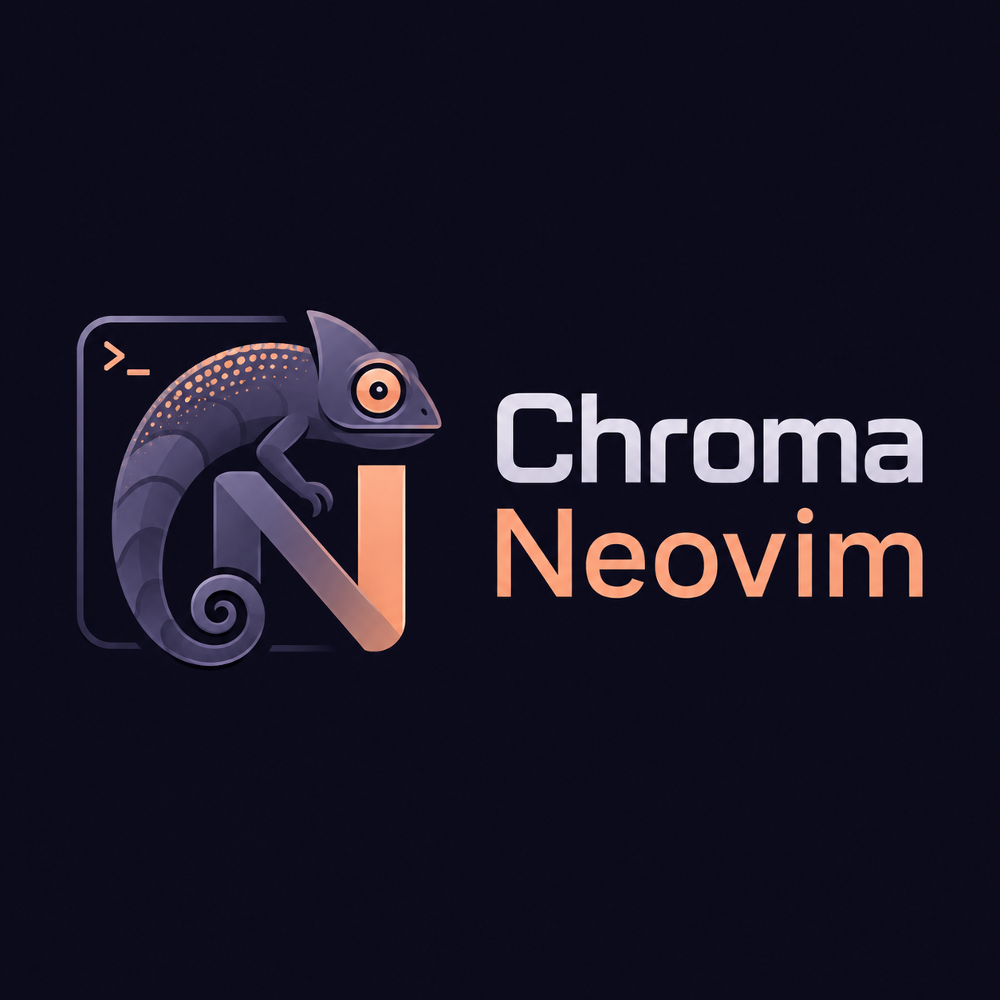
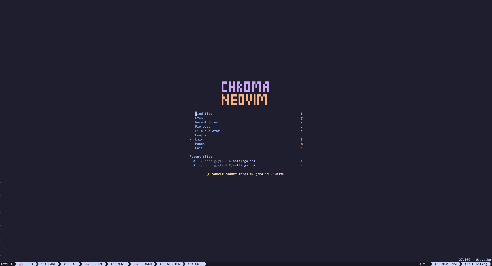
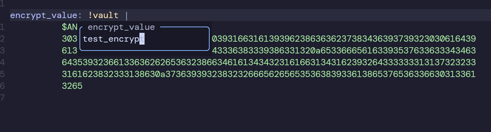
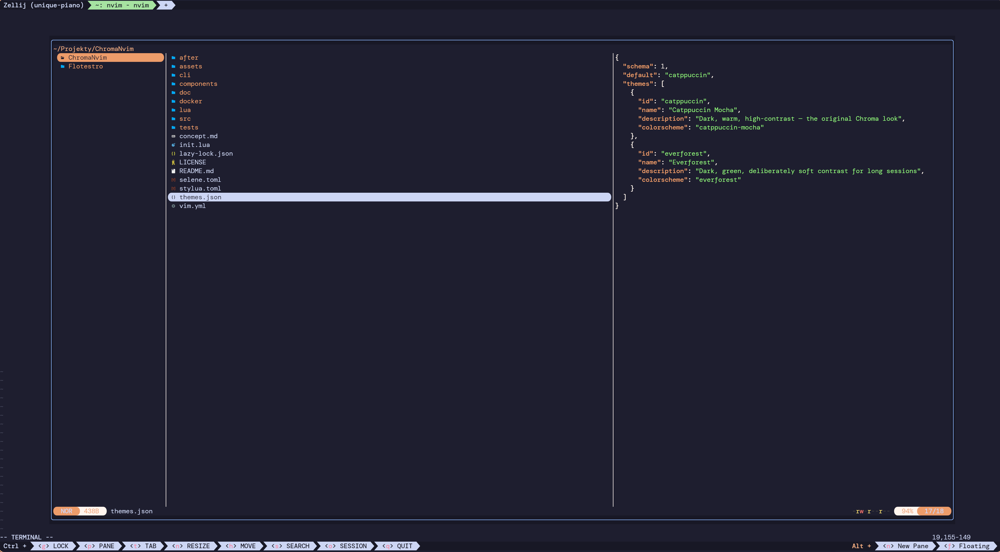
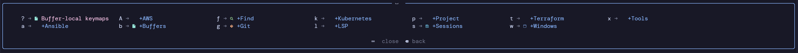

<div align="center">



**A Neovim environment for infrastructure work.**

🚀 fast · 🧩 modular · 🔧 easy to extend · 📦 maintained plugins only · 📝 documented · 🎨 Catppuccin, Everforest or Cyberdream

</div>

---

## What Chroma Neovim is

Chroma Neovim is a complete Neovim environment for people who work with
infrastructure from a terminal: **Terraform / OpenTofu**, **Kubernetes**,
**Helm**, **Ansible**, **Ansible Vault**, **AWS**, **Docker**, **GitHub
Actions**, and the YAML underneath all of it. Language servers, formatters,
linters, parsers, schemas and plugins arrive configured and working — there is
nothing to wire up afterwards.

It is not a set of dotfiles to copy. It is a program you install. `chroma`
installs a release, changes what is in it, updates it, rolls it back and removes
it again, and there is one managed installation per user. Everything the editor
runs on — plugins, language servers, formatters, linters, parsers — is pinned by
the release, so one version installs the same editor twice, on your laptop and
on the box you were handed this morning.

It is not a general-purpose configuration with infrastructure support bolted on
either. That is the starting point, and the choices follow from it: two-space
indentation everywhere, because a tab is a YAML parse error; schema validation
for Kubernetes manifests and workflow files; a Helm language server that
actually attaches; Ansible files recognised by what is in them rather than by
where they happen to sit.

<div align="center">

</div>

### It is modular

A component is one technology's support — its language servers, linters,
formatters, parsers, plugins and schemas. You choose which ones you want, and
what you did not choose is not installed and not loaded: with Kubernetes off
there is no `kubectl.nvim`, and with Helm off no `helm_ls` and no Helm parser
compiled.

| Component | What it adds |
|---|---|
| `core` | The editor itself: plugin management, treesitter, pickers, and the YAML, JSON, Bash and Lua servers. Always installed. |
| `terraform` | Plan, review and apply from the editor, and formatting. |
| `kubernetes` | Cluster views, contexts, namespaces, logs. |
| `helm` | Chart templates: filetype detection, language server, rendering. |
| `ansible` | Playbooks and roles: the execution planner, the language server, linting and documentation. |
| `vault` | Ansible Vault: transparent decrypt, inline values, rekey. |
| `aws` | Profile and region for this session, and identity-bound Terraform plans. |
| `docker` | Dockerfiles and compose files: language servers and linting. |
| `github-actions` | Workflow files: linting, and the schema that validates them. |

### Some of it is Chroma's own

A few things needed more than a plugin, so they were written here. A Terraform
runner where `apply` applies the plan file you read rather than a fresh one, and
can check the AWS account and principal before it does. An Ansible planner that
asks what to run — playbook, working directory, inventory, tags, limit — asks
Ansible what your answers mean, and shows the exact command before starting it.
Transparent editing of Vault files, and per-project tasks. Each one documents
what it does and does not guarantee, in `:help chroma-nvim`.

<div align="center">

<br><sub>Encrypting one value in place, inside an otherwise plain YAML file.</sub>
</div>

## Requirements

### Required

| Dependency | Version | Why |
|---|---|---|
| Neovim | ≥ 0.12 | the native LSP API and the rewritten nvim-treesitter |
| git | ≥ 2.19 | lazy.nvim clones plugins, and partial clones need this |
| A C compiler | `cc`, `gcc` or `clang` | treesitter parsers are compiled locally |
| tree-sitter CLI | ≥ 0.26.1 | parser installation — from your package manager, not from npm |
| Node.js and npm | any supported release | Mason installs the YAML, JSON and Bash language servers from npm, and Node runs them |
| Python 3 with `venv` | any supported release | Mason builds a virtualenv for PyPI packages, `yamllint` among them |
| curl, tar, unzip, gzip | any | downloads, and unpacking parsers and Mason packages |

Node and Python are not optional extras for one component: the core editor alone
installs three npm-backed language servers and one PyPI-backed linter. What is
worth knowing is that installing the obvious package does not always bring all
three, and the splits differ:

| | `node` | `npm` | `python3 -m venv` |
|---|---|---|---|
| Debian, Ubuntu | `nodejs` | separate `npm` | separate `python3-venv` |
| Arch | `nodejs` | separate `npm` | in `python` |
| Fedora | `nodejs` | in `nodejs` | in `python3` |

`chroma doctor` and `:checkhealth chroma` look for the commands `node`, `npm`
and `python3` rather than for packages, so whatever your distribution calls
them, they answer that question directly. Neither can see whether the `venv`
module is there — on Debian and Ubuntu it is the one that is usually missing, and
`python3 -m venv --help` tells you.

The versions are floors rather than pins — each is a requirement stated by
something Chroma depends on. Anything newer works.

### Recommended

| Dependency | Why |
|---|---|
| fzf ≥ 0.36 | every picker |
| ripgrep | the grep pickers |
| fd | project detection |
| bat | file previews |
| A Nerd Font | icons in pickers, trees and completion |

### Optional

| Dependency | Why |
|---|---|
| yazi | the file manager on `<leader>fy` |
| lazygit | the git UI on `<leader>gg` |

### Tools each component uses

These belong to your system. Chroma does not install, upgrade or shadow any of
them, and enabling a component does not ask for one — choosing Kubernetes asks
for Chroma's Kubernetes features, not for `kubectl`. A missing tool never blocks
an installation: `chroma install` names what is not on PATH when it finishes,
`chroma doctor` and `:checkhealth chroma` name it again whenever you ask, and
the feature that needs it says so when you use it.

| Component | Required | Recommended or optional |
|---|---|---|
| `terraform` | `terraform` or `tofu` | `terragrunt` |
| `kubernetes` | `kubectl` | — |
| `helm` | `helm` | — |
| `ansible` | `ansible-playbook`, `ansible-inventory` | `ansible-doc` |
| `vault` | `ansible-vault` | — |
| `aws` | `aws` | — |
| `docker` | — | `docker` |
| `github-actions` | — | — |

## Installation

Download `chroma` from the
[latest release](https://github.com/ultherego/chroma-nvim/releases/latest) and
run it:

```sh
base=https://github.com/ultherego/chroma-nvim/releases/latest/download
curl -fsSLO "$base/chroma-linux-amd64"
curl -fsSLO "$base/SHA256SUMS"
sha256sum --check --ignore-missing SHA256SUMS

chmod +x chroma-linux-amd64 && sudo mv chroma-linux-amd64 /usr/local/bin/chroma

chroma install
```

On ARM machines take `chroma-linux-arm64` instead. Linux is what is built and
tested; there is no macOS or Windows binary.

The checksum says the download is the file the release holds. It is published
beside that file and is not a signature, so it does not say who built it. To
move to a newer `chroma`, download it the same way and replace the old one;
`chroma update` moves the configuration, not the installer.

The installer asks where to put the configuration, which components you want and
which colourscheme to draw, shows the whole plan, and writes nothing until you
agree. By default it installs beside whatever Neovim configuration you already
have, and you start it by name:

```sh
NVIM_APPNAME=chroma-nvim nvim
```

The other placement takes over Neovim's own directories — `~/.config/nvim`,
`~/.local/share/nvim`, `~/.local/state/nvim` and `~/.cache/nvim` — and moves
what was there aside, to be given back if you ever uninstall.

## Uninstalling

```sh
chroma uninstall
```

It prints the exact list of paths before it removes anything. What Chroma made
is removed: the configuration, the kept generations, the plugins, the Mason
packages, the parsers, the cache, the state, your component selection and your
colourscheme. Anything that was in Neovim's own directories before Chroma took
them over is **given back**, not deleted. External tools and Neovim itself are
never touched.

## Install options

Every question the installer asks can be answered in advance instead.

| Option | What it does |
|---|---|
| `--components a,b` | the optional components to install; `core` is always installed |
| `--profile <name>` | a named set: `minimal`, `terraform`, `kubernetes`, `everything` |
| `--theme <id>` | the colourscheme: `catppuccin`, `everforest` or `cyberdream` |
| `--default` | take over `~/.config/nvim` instead of installing beside it |
| `--version <vX.Y.Z>` | a particular release rather than the latest |
| `--dry-run` | build the plan, print it, and write nothing |
| `--yes` | accept the final plan without being asked |
| `--non-interactive` | never ask; anything unanswered is misuse |
| `--plain` | printed questions instead of selectors, also on a terminal (or `CHROMA_PLAIN=1`) |
| `--source-tree <dir>` | install a checkout instead of a release (developer-only) |

A run that names its components is being driven by flags, so it is not asked
anything else either; it takes the release's own colourscheme unless `--theme`
says otherwise.

## Managing an installation

```sh
chroma doctor      # what is installed, and what is missing from PATH
chroma components  # change which components are enabled
chroma update      # move to another release, keeping your components
chroma rollback    # go back to the previous release, keeping your components
chroma version     # this CLI, and the contract it understands
```

Changing components does not change which release you are on, and changing
release does not change your components. An update keeps the release it
replaced, so `rollback` is a local operation rather than a re-download; rolling
back again returns you to where you were. If part of any of this fails, what you
had is put back and the record still describes it.

### When something was interrupted

A command that fails puts things back itself and says so. One that was killed
— a closed terminal, a power cut — cannot, and the next command looks first.

- **Run the command again.** `update`, `rollback`, `components` and `uninstall`
  repair an interrupted update or rollback before doing anything else, and tell
  you what they found. `uninstall` also carries on from an uninstall that
  stopped partway.
- **If it refuses**, it names a directory and says why it will not guess. What
  it names is always beside your configuration: `*.chroma-backup-*` is something
  that was moved aside and is still wanted — yours, or the release you can roll
  back to; `*.chroma-failed-*` and `*.chroma-removing-*` are what a failed
  installation or an unfinished uninstall left, and are safe to delete once you
  have read the log inside.
- **A first `chroma install --default` that was killed** leaves your own
  configuration in `~/.config/nvim.chroma-backup-*`, and the same for
  `~/.local/share/nvim`, `~/.local/state/nvim` and `~/.cache/nvim`. Nothing of
  yours is deleted; move each back to its name and install again.

Every run writes a log, and prints where: `logs/install-*.log` under the
installation's state directory.

| Command | Options |
|---|---|
| `chroma components` | `--set a,b` (what to have afterwards, in full; `--set ''` is core alone), `--yes`, `--non-interactive` (needs `--set`), `--plain`, `--tree <dir>` to list what a tree offers and change nothing |
| `chroma update` | `--version <vX.Y.Z>` (default: latest), `--dry-run`, `--yes`, `--non-interactive` |
| `chroma rollback` | `--dry-run`, `--yes`, `--non-interactive` |
| `chroma uninstall` | `--dry-run`, `--yes`, `--non-interactive` |
| `chroma doctor` | `--tree <dir>` to read a checkout instead of this machine (developer-only) |

### The colourscheme

Three ship, and one is drawn: **Catppuccin Mocha** (the default),
**Everforest** or **Cyberdream**. The release says what it can draw, in `themes.json`; what you
picked is your own, in `$XDG_CONFIG_HOME/chroma/theme.json`, beside your
components — so an update replaces the configuration without replacing your
choice. To change it later, edit that file and restart, or install again with
`--theme`. The plugin you switched away from is never loaded again, and
`:Lazy clean` removes it.

<div align="center">

</div>

## Keymaps

The leader is <kbd>Space</kbd>. Press it and wait, and which-key answers from
inside the editor; `<leader>?` lists what the current buffer adds.

<div align="center">

</div>

Every mapping on one page, including the ones deliberately left to Neovim, is in
[**`doc/KEYMAPS.md`**](https://github.com/ultherego/chroma-nvim/blob/main/doc/KEYMAPS.md).
A test fails if it and the editor stop agreeing. `:help chroma-nvim-keymaps` is
the same set with the reasoning attached.

## Troubleshooting

Most of this configuration drives external programs, and when one is missing the
symptom is usually silence rather than an error. `:checkhealth chroma` reports
what is absent, what stops working without it, and which components are enabled.
`chroma doctor` answers the same question from a shell. `:Lazy` and `:Mason`
cover the plugins and the packages.

If something behaves oddly rather than being absent, `:help
chroma-nvim-troubleshooting` lists the cases that have come up before and what
each one turned out to be.

## Documentation

**In the editor:** `:help chroma-nvim` — every keymap with the reasoning
attached, every component, and the safety model of the modules that handle
secrets and run infrastructure commands. This is the documentation an
installation carries; everything below is in the repository, because it is
written about the project rather than run by it.

- [`doc/KEYMAPS.md`](https://github.com/ultherego/chroma-nvim/blob/main/doc/KEYMAPS.md)
  — every mapping on one page.
- [`doc/DECISIONS.md`](https://github.com/ultherego/chroma-nvim/blob/main/doc/DECISIONS.md)
  — the reasoning behind every choice, and what is deliberately absent.
- [`doc/CONTRACT.md`](https://github.com/ultherego/chroma-nvim/blob/main/doc/CONTRACT.md)
  — the rules this project is built under.
- [`cli/DESIGN.md`](https://github.com/ultherego/chroma-nvim/blob/main/cli/DESIGN.md)
  — the installer.

## Development

The repository is itself a Neovim configuration directory, which is how it is
worked on. This is not the installation route: it skips the release
verification, the transaction, the install state and everything `update`,
`rollback` and `uninstall` depend on.

```sh
git clone https://github.com/ultherego/chroma-nvim.git ~/.config/chroma-nvim
NVIM_APPNAME=chroma-nvim nvim
```

`chroma install --source-tree .` installs a checkout through the real installer,
which is how the two are kept honest. `doc/CONTRACT.md` covers the test suite,
the linters and how installations are tested in a container.

## License

[MIT](./LICENSE)
